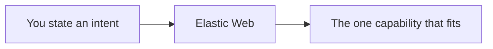

  

<h3 align="center">I build Elastic Web.</h3>

You state an intent. The service does that thing, not everything it could do.

  <a href="https://vedaxi.com/elasticweb">Live view</a>
  ·
  <a href="https://vedaxi.com">Vedaxi</a>
  ·
  <a href="https://www.luxurylifestyle.co">Travel writing</a>

Vedaxi is the name. Elastic Web is the product.

| Work | What it is |
| --- | --- |
| [Elastic Web](https://github.com/luxurylifestyleco/vedaxi-elastic) | The open protocol. [Live view](https://vedaxi.com/elasticweb). |
| [Skill Router](https://github.com/luxurylifestyleco/skill-router) | One skill, before the model runs. |
| [VDX Android](https://github.com/luxurylifestyleco/vdx-android) | Say a name. Confirm. The phone dials. |
| [CodeNotes](https://github.com/luxurylifestyleco/codenotes) | A meeting workspace. Capture is never faked. |
| [Research-integrity desk](https://github.com/luxurylifestyleco/vedaxi-integrity-desk) | A human confirms evidence. Not Elastic Web. |
