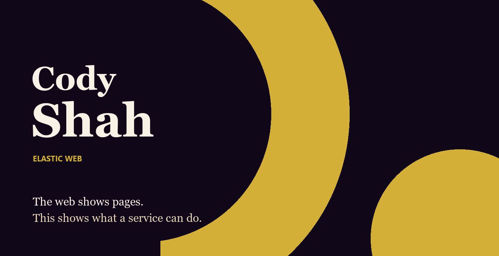
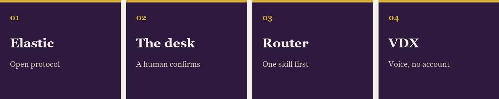

I build Elastic Web.

The web hands you a page. I want it to hand you what a service can do, then do the thing you meant.

A company's agent should walk in, send a task, and stay in the room. The open protocol is public. The session that keeps them there is the next cut.

[Vedaxi Elastic](https://github.com/luxurylifestyleco/vedaxi-elastic) is the open protocol.

[Vedaxi Elastic Web](https://github.com/luxurylifestyleco/vedaxi-elastic-web) is the desk. An agent may propose. A human confirms.

[Skill Router](https://github.com/luxurylifestyleco/skill-router) picks one skill before the model runs.

[VDX Android](https://github.com/luxurylifestyleco/vdx-android) is the voice. Call a person from what you said. No account. No cloud.

[CodeNotes](https://github.com/luxurylifestyleco/codenotes) is the meeting. Capture is never faked.

Live view: [vedaxi.com/elasticweb](https://vedaxi.com/elasticweb)

Vedaxi is the name on the door. [vedaxi.com](https://vedaxi.com)

This username is the travel writing. [luxurylifestyle.co](https://www.luxurylifestyle.co)
